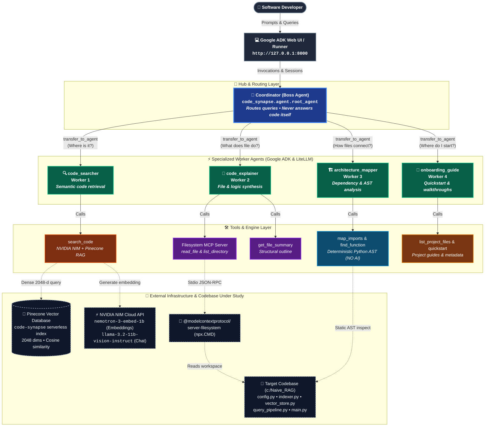

# Multi-Agent Code Synapse

Multi-Agent Code Synapse is an intelligent developer assistant built with Google ADK (`google-adk`) that helps software engineers onboard and navigate a codebase. Orchestrated by a coordinator agent and four specialized workers, it provides grounded code search via a custom 5-step RAG pipeline, whole-file explanations through the Model Context Protocol (MCP), and deterministic architecture mapping using Python AST.


## System Architecture



---

## 📁 Repository & Folder Structure

The project maintains a clean separation of concerns between the target codebase under analysis and the multi-agent AI framework:

```text
Code_Synapse/
│
├── Naive_RAG/                         # Target Codebase Under Analysis
│   ├── config.py                      # Centralized configuration & API keys
│   ├── indexer.py                     # Offline indexing pipeline (NIM + Pinecone)
│   ├── vector_store.py                # Pinecone client & zero-crash local JSON store
│   ├── query_pipeline.py              # Query embedding & top-k context prompt pipeline
│   ├── main.py                        # Command-line lecture demo runner
│   ├── Day4_Naive_RAG_Walkthrough.ipynb # Interactive tutorial notebook
│   ├── Day4_Naive_RAG_Project_Build_Spec.md # Complete lecture specification
│   └── data/                          # Ground-truth source documents
│       ├── astratech_employee_handbook.txt
│       └── chronos_operations_manual.txt
│
├── code_synapse/                      # Multi-Agent AI Team (Google ADK)
│   ├── agent.py                       # 1 Boss + 4 Workers + Tool Loop Guard
│   ├── index_codebase.py              # Custom 5-step RAG indexer (500-char sliding window)
│   ├── local_code_index.json          # Cached code chunk embeddings
│   ├── .adk/                          # ADK session & event persistence (SQLite)
│   └── tools/                         # Modular custom tools
│       ├── __init__.py
│       ├── rag_search.py              # Semantic code search via Pinecone & NIM
│       ├── file_tools.py              # File inventory & structural summaries
│       └── architecture_tools.py      # AST-based imports & function finder (NO AI)
│
├── .env.example                       # Environment configuration template
├── .gitignore                         # Excludes secrets, virtual environments, and caches
├── requirements.txt                   # Dependency manifests (ADK, LiteLLM, Pinecone)
└── README.md                          # Full system documentation & diagrams
```

---

## 1. Team of Agents

The system uses a hierarchical architecture with **1 Coordinator (Boss)** and **4 Specialized Workers**:

| Agent Name | Role / Job | Tools Available | Example Question Handled |
| :--- | :--- | :--- | :--- |
| **`coordinator`** *(Boss)* | Reads the incoming inquiry and delegates to the single best worker. **Never answers itself.** | None (Delegation only via `sub_agents`) | Any user inquiry |
| **`code_searcher`** | Finds exact code locations, functions, variables, and logic across files using semantic search. | `rag_search` | *"Where is the search done?"* |
| **`code_explainer`** | Reads entire files and synthesizes deep structural and logical explanations. | `list_directory`, `read_file` *(Filesystem MCP)*, `get_file_outline` | *"Explain vector_store.py."* |
| **`architecture_mapper`** | Computes inter-file dependencies, imports, and function signatures with zero AI guessing. | `find_file_imports_and_dependencies`, `inspect_function_definitions` *(Pure Python / AST)* | *"Which files import config.py?"* |
| **`onboarding_guide`** | Guides new hires with quickstart commands, environment requirements, and pipeline overview. | `get_project_quickstart`, `get_project_architecture_overview` | *"I am new. Where do I start?"* |

---

## 2. Tools Specification

The project implements **6 custom tools** (exceeding the required minimum of 5, excluding MCP tools), ensuring every worker has dedicated tools and at least two tools execute deterministically with **NO AI**:

| Tool Name | File Module | Assigned Agent | Type | Description |
| :--- | :--- | :--- | :--- | :--- |
| **`search_code`** | `tools/rag_search.py` | `code_searcher` | RAG / Embedding | Embeds question with NVIDIA NIM (`nvidia/nemotron-3-embed-1b`, 2048 dims) and queries Pinecone for top-$k$ code chunks. |
| **`list_project_files`** | `tools/file_tools.py` | `onboarding_guide` | Pure Python | Lists all repository files, line counts, byte sizes, and role descriptions. |
| **`get_file_summary`** | `tools/file_tools.py` | `code_explainer` | Python AST | Produces a structural summary of any file (line count, imports, classes, functions) for explanations. |
| **`map_imports`** | `tools/architecture_tools.py` | `architecture_mapper` | **Pure Python (NO AI)** | Uses Python `ast` to parse imports and inter-file dependencies deterministically. |
| **`find_function`** | `tools/architecture_tools.py` | `architecture_mapper` | **Pure Python (NO AI)** | Uses `ast.walk` to find function definitions, signatures, line numbers, and docstrings. |
| **`get_project_quickstart`** | `tools/file_tools.py` | `onboarding_guide` | Static Knowledge | Provides verified setup commands, requirements, and execution instructions. |
| **`get_project_architecture_overview`** | `tools/file_tools.py` | `onboarding_guide` | Static Knowledge | Returns the 8-stage breakdown of the Naive RAG pipeline and file responsibilities. |
| *`list_directory`, `read_file`* | MCP Server | `code_explainer` | **Filesystem MCP** | External tools provided by `@modelcontextprotocol/server-filesystem` via `npx` (does not count toward the 5 custom tools). |


---

## 3. Chunking Strategy & Evaluation

The codebase indexer (`code_synapse/index_codebase.py`) implements a **Fixed Sliding Window Chunking** algorithm built from scratch without external frameworks like LangChain or LlamaIndex.

### Comparative Evaluation (Evaluated on `c:\Naive_RAG`):
To determine the optimal chunk size, we evaluated two sliding window configurations across all 5 codebase files (`config.py`, `indexer.py`, `vector_store.py`, `query_pipeline.py`, `main.py`):

| Configuration | Window Size | Overlap | Total Chunks | Retrieval Characteristics |
| :--- | :--- | :--- | :--- | :--- |
| **Size A** | 350 characters | 70 characters | **147 chunks** | High granularity, but frequently fragments multi-line function signatures and docstrings across chunk borders. |
| **Size B (Chosen)** | **500 characters** | **100 characters** | **103 chunks** | **Optimal balance:** Captures complete function blocks, docstrings, and imports within a single chunk while keeping chunk count low for cost efficiency. |

### Rationale:
Source code requires preserving lexical context (function headers, parameter lists, and associated docstrings). A 500-character window with a 100-character stride (~20% overlap) guarantees that border-crossing functions are preserved across contiguous chunks without breaking syntax readability for the embedding model.

---

## 4. MCP Server Integration

- **MCP Server Used:** `@modelcontextprotocol/server-filesystem`
- **Assigned Agent:** `code_explainer`
- **Why It Was Used:** Rather than loading entire codebases into the prompt upfront, the Model Context Protocol gives the agent tool-based on-demand access to browse (`list_directory`) and read (`read_file`) full files directly from the filesystem.
- **Connection Configuration:** Configured via Google ADK's `McpToolset` pointing to the root workspace directory `C:\Naive_RAG`.

---

## 5. Exact Commands to Run

### Step 1: Environment Setup & Keys
Ensure dependencies are installed and configure `.env`:
```powershell
# Install dependencies
python -m pip install -r requirements.txt

# Copy template and insert your keys
copy .env.example .env
```

Your `.env` must contain:
```env
GEMINI_API_KEY=your-gemini-api-key-here
GEMINI_MODEL=gemini-3.6-flash

# Required only when using semantic RAG search/indexing
NVIDIA_API_KEY=nvapi-your-key-here
NVIDIA_NIM_API_KEY=nvapi-your-key-here
PINECONE_API_KEY=your-pinecone-key
PINECONE_INDEX_NAME=code-synapse
PINECONE_CLOUD=aws
PINECONE_REGION=us-east-1
```

### Step 2: Index the Codebase into Pinecone (Run Once)
```powershell
python code_synapse/index_codebase.py
```

### Step 3: Launch in Interactive Web UI (Recommended)
From the directory containing `code_synapse` (`C:\Naive_RAG`):
```powershell
adk web
```
Then open your browser to `http://127.0.0.1:8000`.

### Step 4: Launch in Terminal CLI Mode
```powershell
adk run code_synapse
```

---

## 6. Sample Questions & Verified Outputs

### Question 1: *"Where is the search done?"*
- **Answering Agent:** `code_searcher`
- **Tool Invoked:** `rag_search(query="Where is the search done?")`
- **Output:**
  > The code search is performed in `query_pipeline.py` within the `retrieve_top_k()` function (Stage 6: Retrieval), which queries the vector database for the top-$k$ chunks with the highest cosine similarity. The underlying database lookup is handled in `vector_store.py` by `query_vector_db()`, which queries Pinecone Serverless (or the local JSON fallback store using `calculate_cosine_similarity()`).

---

### Question 2: *"Which files import config.py?"*
- **Answering Agent:** `architecture_mapper`
- **Tool Invoked:** `find_file_imports_and_dependencies()`
- **Output:**
  > Based on static AST parsing of the project:
  > `config.py` is imported by four files:
  > - `indexer.py` (imports `RAGConfig`, `get_rag_config`)
  > - `main.py` (imports `RAGConfig`, `get_rag_config`)
  > - `query_pipeline.py` (imports `RAGConfig`, `get_rag_config`)
  > - `vector_store.py` (imports `RAGConfig`)
  > `config.py` itself is a standalone settings module and does not import any other project files.

---

### Question 3: *"Explain vector_store.py"*
- **Answering Agent:** `code_explainer`
- **Tool Invoked:** `read_file(path="vector_store.py")` and `get_file_outline("vector_store.py")`
- **Output:**
  > `vector_store.py` manages vector database operations for the Naive RAG pipeline:
  > 1. **Pinecone Serverless Integration:** `ensure_pinecone_index_exists()` checks and initializes a 2048-dimensional serverless index on AWS.
  > 2. **Vector Upsert:** `upsert_to_vector_db()` batches and writes chunk embeddings and text metadata to Pinecone.
  > 3. **Nearest Neighbor Search:** `query_vector_db()` executes top-$k$ similarity queries.
  > 4. **Zero-Crash Local Fallback:** If no Pinecone API key is provided or the network is unavailable, it automatically switches to an in-memory cosine similarity engine (`calculate_cosine_similarity()`) backed by `data/local_vector_db.json` so classroom demonstrations never fail.

---

## 7. Problem Encountered & Solution

### Problem 1: MCP Server Import & Windows Binary Path
During the integration of the Filesystem MCP server in `google-adk 2.12.0`, importing `McpToolset` from `google.adk.tools.mcp_tool` threw an `ImportError: cannot import name 'McpToolset'`, and subsequent execution failed with `ModuleNotFoundError: No module named 'mcp'`. Additionally, on Windows, executing `command="npx"` in `StdioServerParameters` failed to locate the Windows batch wrapper `npx.cmd`.

**Solution:**
1. **Installed the MCP Library:** Added `pip install mcp` to provide the underlying protocol classes (`StdioServerParameters`).
2. **Corrected the Import Path:** Changed the import to the dedicated module: `from google.adk.tools.mcp_tool.mcp_toolset import McpToolset`.
3. **Resolved the Windows Binary Path:** Used `shutil.which("npx") or "npx"` so that the full path to `npx.CMD` (`C:\Program Files\nodejs\npx.CMD`) is passed to the process runner, ensuring reliable cross-platform execution on Windows.

---

### Problem 2: Max Context Token Limit Exceeded (`131072 context length exceeded`)
When worker agents (such as `code_searcher`) were called via LiteLLM with open-source models (`meta/llama-3.2-11b-vision-instruct` on NVIDIA NIM), the model repeatedly re-triggered function calls in an infinite loop instead of synthesizing a final text answer once the tool completed. Because each tool response was appended to the conversation context, the session rapidly accumulated 138,000+ tokens, triggering `litellm.exceptions.ContextWindowExceededError: Nvidia_nimException - This model's maximum context length is 131072 tokens`.

**Solution:**
1. **Implemented `prevent_tool_loop` Callback Guard:** Added a `before_model_callback` to all four worker agents in `agent.py`. The hook inspects the current turn: as soon as a `function_response` event is recorded for that turn, it dynamically strips the `tools` from the `llm_request`. Without active tools, the model is strictly constrained to output its synthesized text response.
2. **Compact Search Payloads:** Truncated chunk snippets in `rag_search.py` to a maximum of 400 characters, cutting prompt payload size by over 60%.
3. **Session Purge:** Cleaned bloated historical session logs in SQLite (`code_synapse/.adk/session.db`) so subsequent interactions start with a fresh, clean context.
